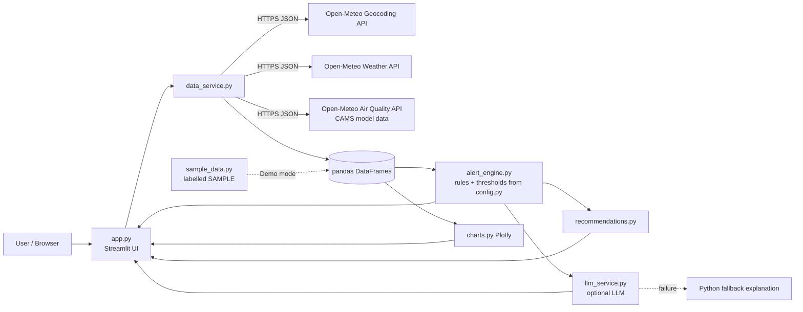
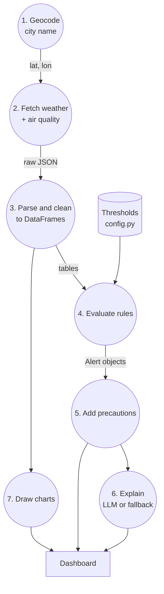
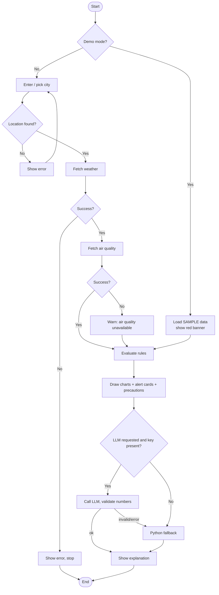

# Kaniyan.AI — Location-Based Environmental Risk Alert System
### Python Programming Mini-Project Report

*(Insert: Team names, register numbers, department, college, guide name, academic year.)*

---

## 1. Project Title
**Kaniyan.AI — Location-Based Environmental Risk Alert System**

## 2. Abstract
Weather apps show numbers, but ordinary users must decide for themselves whether those numbers matter.
Kaniyan.AI is a Python/Streamlit web dashboard that retrieves current weather, a 7-day forecast and a
5-day air-quality forecast for a chosen city using the free Open-Meteo APIs. It applies a transparent,
configurable rule-based engine to flag heavy rainfall, high temperature, strong wind gusts and poor
air quality, assigns three warning levels (Information, Caution, High concern), explains *why* each
alert fired, and suggests practical precautions. An optional Large Language Model (LLM) can rephrase
the results in simple language; all calculations and alert decisions stay in Python, and an ordinary
Python fallback is used when the LLM is unavailable. Kaniyan.AI is an educational prototype: its alerts are
not official warnings, and it does not predict street-level flooding.

## 3. Introduction
Chennai and other Tamil Nadu cities experience intense monsoon rain, hot summers and, at times, poor air
quality. Public information exists (forecast models, air-quality models), but it is spread across sources,
expressed in technical units, and rarely connected to *what a person should do*. Kaniyan.AI combines
these sources in one dashboard and adds an interpretation layer.

## 4. Problem Statement
Raw environmental data are hard to interpret quickly. Users need a single, understandable view of
upcoming conditions for their location, with clear, explainable indications of potentially concerning
values and sensible precautions — without the tool overstating its certainty or posing as an official authority.

## 5. Motivation and Real-World Relevance
- Daily decisions (travel, outdoor work, children's activities, asthma management) depend on rain, heat and air quality.
- Forecast numbers (e.g. "72 mm") are meaningless to most people without context; thresholds and explanations add context.
- Explainable rules are suitable for safety-related information because users and examiners can inspect them.
- The project demonstrates practical Python skills: APIs, JSON, data processing, visualisation, error handling, testing.

## 6. Objectives
1. Let a user select/enter a city and geocode it. 2. Show current temperature, humidity, wind, condition.
3. Show a 7-day forecast including rainfall. 4. Show air quality (US AQI and PM2.5/PM10 etc.).
5. Visualise trends with interactive charts. 6. Detect concerning conditions with configurable rules.
7. Display levels and explanations. 8. Suggest precautions. 9. Show data sources and timestamps.
10. Optionally generate LLM explanations with a safe Python fallback.

## 7. Existing-System Limitations
| Typical existing tool | Limitation addressed by Kaniyan.AI |
|---|---|
| General weather apps | Show values but not why they matter or what to do |
| Separate AQI apps/sites | Weather and air quality are in different places |
| Official warnings (IMD etc.) | Authoritative but broad-area; not a personalised dashboard (Kaniyan.AI does *not* replace them) |
| "AI" apps | Can invent facts; Kaniyan.AI keeps decisions in Python and validates LLM output |

## 8. Proposed System
A modular Python application: a data layer (`data_service.py`) fetches and parses API data; a rule layer
(`alert_engine.py`) generates alerts from editable thresholds (`config.py`); a content layer
(`recommendations.py`) maps alerts to precautions; an optional explanation layer (`llm_service.py`)
produces text; and the UI (`app.py`, `charts.py`) presents everything. **Implemented features only** are listed
in this report; items such as SMS notifications or official-warning feeds appear under *Future Enhancements*.

## 9. System Requirements
**Hardware:** any PC/laptop (2 GB RAM minimum, 4 GB recommended), internet connection (for live mode).
**Software:** Windows 10/11 or Ubuntu 22.04+, Python 3.10+, a modern browser, VS Code or PyCharm;
packages: streamlit, requests, pandas, plotly, python-dotenv, (optional) groq, pytest.

## 10. Functional Requirements
FR1 Search/select a location. FR2 Retrieve current weather. FR3 Retrieve daily forecast.
FR4 Retrieve air quality. FR5 Draw charts. FR6 Evaluate alert rules. FR7 Display alert cards with value,
rule, time, level, explanation, precautions, source, timestamp. FR8 Edit thresholds. FR9 Provide an
explanation (LLM optional, fallback always). FR10 Demo mode with clearly labelled sample data.
FR11 Download alerts as CSV. FR12 Show errors clearly.

## 11. Non-Functional Requirements
Usability (simple dashboard), reliability (graceful failures, caching), transparency (visible rules and
sources), security (keys in `.env`, excluded by `.gitignore`), maintainability (modules, tests),
performance (10-minute caching, ~3 API calls per city), honesty (no unsupported claims, sample data labelled).

## 12. System Architecture


## 13. Data Flow Diagram


## 14. Flowchart


## 15. Module Descriptions
| Module | Responsibility | Key Python concepts |
|---|---|---|
| `config.py` | URLs, thresholds, `Level` enum, WMO code table, AQI bands | constants, dict, `IntEnum` |
| `data_service.py` | Geocoding, API calls, parsing, custom exceptions | `requests`, `try/except`, dataclasses, pandas |
| `alert_engine.py` | `classify()`, per-variable rules, `Alert` objects, sorting | functions, loops, NaN handling, `sorted(key=)` |
| `recommendations.py` | Precautions per variable/level, de-duplication | nested dicts, sets |
| `llm_service.py` | Payload, API call, validation, fallback | env vars, JSON, regex, exceptions |
| `charts.py` | Plotly figures with threshold lines | functions, objects |
| `app.py` | Layout, caching, session state | Streamlit widgets, f-strings |
| `sample_data.py` | Invented offline data in API format | list comprehension, `datetime` |

## 16. Algorithms and Pseudocode
**Classification**
```
function classify(value, cutoffs):
    if value is missing: return NONE
    if value >= cutoffs.high:    return HIGH
    if value >= cutoffs.caution: return CAUTION
    if value >= cutoffs.info:    return INFO
    return NONE
```
**Daily rule (rain, temperature, feels-like, gust)**
```
for each forecast day:
    level = classify(day.value, thresholds[rule])
    if level exists: create Alert(value, rule text, date, level, explanation, advice, source, timestamp)
```
**Air quality rule** — group hourly US AQI by date, take the day's maximum, classify it, create one alert per triggering day.
**Main**: run all rules → sort by (level descending, time ascending) → display.
**LLM safety**: build payload from real data → call LLM → reject if error/empty/numbers (>10) not in payload → else fallback.

## 17. API and Data-Source Descriptions
(Verified against the documentation pages listed in References, accessed 20 Oct 2026.)
| API | Endpoint | Used parameters | Notes |
|---|---|---|---|
| Geocoding | `https://geocoding-api.open-meteo.com/v1/search` | `name`, `count`, `language`, `format` | Based on GeoNames; omits `results` when nothing found |
| Weather forecast | `https://api.open-meteo.com/v1/forecast` | `latitude`, `longitude`, `current`, `hourly`, `daily`, `timezone=auto`, `forecast_days=7` | Up to 16 days possible; weather models from national weather services |
| Air quality | `https://air-quality-api.open-meteo.com/v1/air-quality` | `latitude`, `longitude`, `current`, `hourly`, `timezone=auto`, `forecast_days=5` | CAMS model data; `us_aqi` and `european_aqi` are *model-calculated*, "maximum of individual indices"; 5 days default, up to 7 |
**Limits (free, non-commercial):** 600 calls/min, 5,000/hour, 10,000/day, 300,000/month. **Licence:** data CC BY 4.0; attribution required.
**AQI scales:** US AQI bands 0–50 Good … 300–500 Hazardous; European AQI uses a different 0–100+ scale. Kaniyan.AI displays US AQI for alerts and shows the European value only as a labelled number; scales are never mixed.

## 18. Python Concepts Used
Variables, data types, functions with type hints, modules/imports, lists/dicts/sets, loops and comprehensions,
conditionals, classes and dataclasses, enums, exceptions (custom hierarchy), f-strings, `datetime`, JSON,
HTTP with `requests`, pandas DataFrames (filtering, grouping, `to_numeric`, `to_datetime`), regular expressions,
environment variables, caching, unit testing with pytest and mocking (`monkeypatch`).

## 19. Implementation Details
- **Missing data:** values `null` become `NaN`; `is_missing()` guards every comparison.
- **Errors:** `NetworkError`, `RateLimitError`, `LocationNotFoundError`, `DataFormatError` derive from `DataServiceError`; the UI catches the base class.
- **Pure parsing functions** (`parse_weather`, `parse_air_quality`) take JSON and return objects, so they are testable without internet.
- **Caching:** `st.cache_data(ttl=600)` limits API calls.
- **Transparency:** every alert stores its rule text, source and generation time; `official=False` always.
- **Flood safeguard:** rainfall alerts append a fixed sentence that they do not predict street-level flooding.

## 20. Testing Strategy and Test Cases
39 automated pytest tests (sample/mocked data — they verify logic, **not** accuracy against real weather).
| Area | Example input | Expected output |
|---|---|---|
| Threshold boundary | value 20 with cut-offs 10/20/30 | CAUTION |
| Missing/NaN value | `None`, `NaN`, `"abc"` | no alert, no crash |
| Rain sample | 72 / 118 / 30 mm | CAUTION / HIGH / INFO; `None` day ignored |
| Flood wording | any rain alert | explanation contains "NOT predict street-level flooding" |
| Air quality | daily peaks 75,100,135,180,105 | INFO, INFO, CAUTION, HIGH, CAUTION |
| Invalid thresholds | info 100 > caution 50 | `ValueError` |
| Geocoding success / unknown | mocked JSON / no `results` | list of locations / `LocationNotFoundError` |
| Network failure | `ConnectionError`, `Timeout` | `NetworkError` |
| Rate limit | HTTP 429 | `RateLimitError` |
| Bad JSON / API error | invalid JSON / `{"error":true}` | `DataFormatError` / `DataServiceError` |
| Parsing | sample 7-day JSON | 7 daily rows, 168 hourly rows, nulls → NaN |
| Unavailable AQI | `None`, `NaN` | "Unavailable" |
| LLM failure / empty / invented numbers / no key | fake client | Python fallback + reason |
| App smoke test | Demo mode | no exception; SAMPLE banner shown |
**Validation against reality** (manual, optional): compare displayed values for your city with IMD/CPCB/other public sources at the same time and note differences. Not automated.

## 21. Results and Expected Screenshots
Include screenshots of: (1) sidebar + Overview with current metrics; (2) Forecast table and charts; (3) Air-quality tab with
US AQI chart and the "which index is this?" note; (4) Alerts tab with an expanded HIGH alert; (5) error message when offline;
(6) Demo mode banner; (7) explanation with source label ("LLM" / "Python fallback"). Describe what each shows. Do not
include screenshots you did not take.

## 22. Limitations
Model-based forecasts have errors; ~11–45 km air-quality model grids cannot represent street-level pollution; thresholds are
illustrative; no official warning feed; no flood model; free API is non-commercial and rate-limited; no user accounts or notifications;
LLM explanations may be unavailable and are limited to supplied data.

## 23. Privacy, Safety and Data Reliability
No personal data stored; only the typed place name and coordinates are sent to Open-Meteo (and a summary to the LLM provider if enabled).
API keys live in `.env`. Alerts are labelled experimental. Users are directed to IMD, CPCB and state authorities. Sample data is
always labelled. Sources and timestamps are displayed.

## 24. Future Enhancements (not implemented)
Official IMD warning integration (if a suitable licensed feed is available), ground-station AQI (e.g. CPCB/OpenAQ) comparison,
Tamil-language interface, email/SMS notifications, saved locations, validation against historical data, a validated local flood model.

## 25. Conclusion
Kaniyan.AI turns raw forecast and air-quality data into explainable, location-based alerts and precautions using simple, testable Python
rules, with robust error handling and an optional, safely constrained LLM layer. It demonstrates core programming skills and a responsible
approach to presenting environmental information.

## 26. References
Pages below were opened and read on **20 October 2026**:
1. Open-Meteo, "Weather Forecast API" — https://open-meteo.com/en/docs (accessed 20 Oct 2026)
2. Open-Meteo, "Air Quality API" — https://open-meteo.com/en/docs/air-quality-api (accessed 20 Oct 2026)
3. Open-Meteo, "Geocoding API" — https://open-meteo.com/en/docs/geocoding-api (accessed 20 Oct 2026)
4. Open-Meteo, "Pricing" (free-tier limits, licence FAQ) — https://open-meteo.com/en/pricing (accessed 20 Oct 2026)

Official sources to consult and cite after you open them yourself (**not reviewed when this template was written — add your own access dates**):
5. India Meteorological Department — https://mausam.imd.gov.in
6. Central Pollution Control Board — https://cpcb.nic.in
7. US EPA AQI basics — https://www.airnow.gov/aqi/aqi-basics/
8. Copernicus Atmosphere Monitoring Service — https://atmosphere.copernicus.eu
9. Groq API documentation (for the optional LLM feature) — https://console.groq.com/docs
10. Streamlit documentation — https://docs.streamlit.io
